<!-- Generated: README.md and assets/ are built by github-profile/ in the portfolio repo (python3 build.py && python3 readme.py). Edit the source there, not this file. -->

<picture><source media="(prefers-color-scheme: dark)" srcset="assets/hero-dark.svg"></picture>

<a href="https://calendly.com/aboulnasrsherif/30min"><picture><source media="(prefers-color-scheme: dark)" srcset="assets/btn-call-dark.svg"></picture></a>&nbsp;
<a href="mailto:aboulnasrsherif@gmail.com"><picture><source media="(prefers-color-scheme: dark)" srcset="assets/btn-email-dark.svg"></picture></a>&nbsp;
<a href="https://linkedin.com/in/sherif-aboulnasr"><picture><source media="(prefers-color-scheme: dark)" srcset="assets/btn-linkedin-dark.svg"></picture></a>

 

<picture><source media="(prefers-color-scheme: dark)" srcset="assets/proof-dark.svg"></picture>

 
 

<picture><source media="(prefers-color-scheme: dark)" srcset="assets/head-work-dark.svg">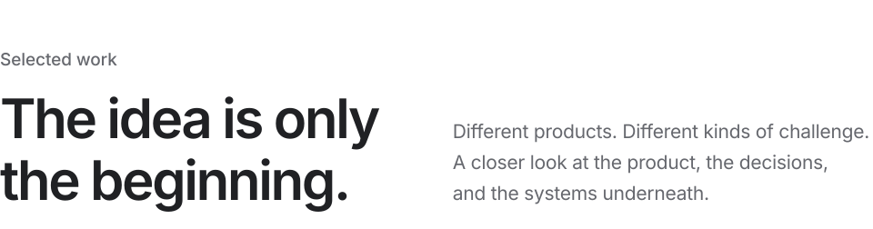</picture>

 

<a href="https://apps.apple.com/us/app/dosely-peptide-tracker/id6759814549"><picture><source media="(prefers-color-scheme: dark)" srcset="assets/dosely-dark.svg"></picture></a>

Schedules, vial inventory, calculations, and reminders in one native app. I built the SwiftUI experience and the systems behind it, with a cache-first architecture that keeps the daily workflow close at hand.

<a href="https://apps.apple.com/us/app/dosely-peptide-tracker/id6759814549"><picture><source media="(prefers-color-scheme: dark)" srcset="assets/btn-appstore-dark.svg"></picture></a>&nbsp;
<a href="https://dosely.cc"><picture><source media="(prefers-color-scheme: dark)" srcset="assets/btn-product-dark.svg"></picture></a>

<b>Inside the build</b>&nbsp;&nbsp;Designing the architecture around the daily experience.

 

**My role.** Sole engineer at EFN Group. Native app, data layer, subscription integration, release, and production maintenance.

**The challenge.** Logging a dose affects a schedule, an inventory, and an ongoing protocol. These connected tasks should feel like one coherent routine, even when the network is unreliable.

**The decision.** After production experience with shared state, I moved toward singleton-free, cache-first repositories. Screens read local data first while the backend handles persistence and sync.

**The tradeoff.** Local responsiveness makes synchronization and state ownership more important. Explicit repositories give each screen a clear data boundary and make those responsibilities easier to follow.

<picture><source media="(prefers-color-scheme: dark)" srcset="assets/dosely-arch-dark.svg">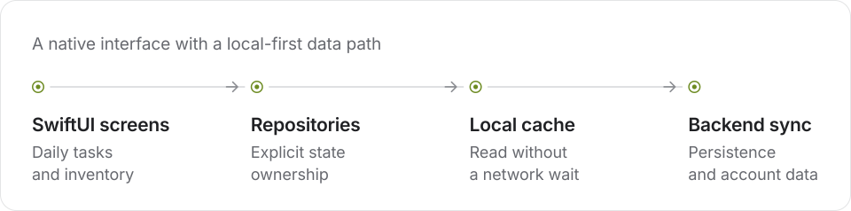</picture>

**In production.** A subscription app with camera-assisted vial entry, cycle planning, and a compound library. The October 2026 portfolio snapshot records 100K+ downloads and $130K+ revenue.

 
 

<a href="https://www.deckdrop.co/"><picture><source media="(prefers-color-scheme: dark)" srcset="assets/deckdrop-dark.svg"></picture></a>

Turn a topic, article, or PDF into social slides you can make your own. I built DeckDrop with AI-assisted drafting, a visual editor, reusable brand kits, and exports sized for five platforms.

<a href="https://www.deckdrop.co/"><picture><source media="(prefers-color-scheme: dark)" srcset="assets/btn-deckdrop-dark.svg"></picture></a>

<b>Inside the build</b>&nbsp;&nbsp;Keeping AI output editable, exportable, and dependable.

 

**My role.** Product engineering across generation, the visual editor, server rendering, saved drafts, and subscription credits.

**The challenge.** A generated image locks in the design too early. Creators need to rewrite a hook, move a text layer, change a background, and adapt the same idea to another platform.

**The decision.** The pipeline returns structured slide content and editable state. The editor adds layers, undo/redo, and autosave. Each slide renders on the server with Satori, Resvg, and Sharp; the browser packages the results into a ZIP.

**The production details.** Generation involves model calls, image sourcing, and rendering. Server-side credit checks gate each paid operation, failed work triggers a refund, and compressed image payloads keep responses within serverless limits.

<picture><source media="(prefers-color-scheme: dark)" srcset="assets/deckdrop-flow-dark.svg">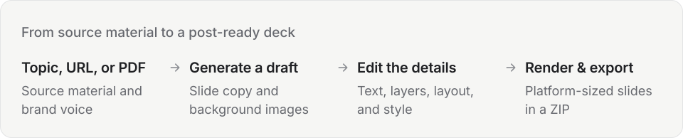</picture>

**A complete creator workflow.** Drafting, editing, saved brand styles, shared libraries, and downloadable slides for TikTok, Instagram, Reddit, LinkedIn, and X.

 
 

<picture><source media="(prefers-color-scheme: dark)" srcset="assets/codexflow-dark.svg"></picture>

<b>Inside the build</b>&nbsp;&nbsp;The hard part is what happens after something fails.

 

**A code review, orchestrated.**

1. **Queue three independent reviews.** This example queues reviews of concurrency and resume behavior, child processes, and CLI rendering. Each task has its own scope.
2. **Run the reviews in parallel.** The three independent tasks are running. The workflow coordinates their work and collects each result as it finishes.
3. **One task is interrupted.** Two reviews have completed. The CLI rendering review fails in this example, leaving that task unfinished while the completed results remain available.
4. **Resume the unfinished task.** The completed reviews are reused from cache. Only the unfinished CLI rendering review runs again.
5. **Collect all three results.** The remaining review completes. The workflow now has all three outputs, including the two results retained from the earlier run.

**The challenge.** A long agent run can fail after useful work has already finished. Starting over wastes that work; blindly continuing can reuse results that no longer apply.

**The decision.** I built an append-only event journal and content-addressed resume cache. Unchanged successful calls can replay their validated results. Failed calls run again.

**The boundary.** Recovery also means managing process trees, protecting concurrent resume operations, and preserving output during worktree cleanup. When dependent state changes, a fresh run keeps the assumptions explicit.

**Built for my workflow.** JavaScript orchestration, configurable concurrency, schema-validated outputs, and optional worktree isolation.

 

<picture><source media="(prefers-color-scheme: dark)" srcset="assets/tool-beam-dark.svg">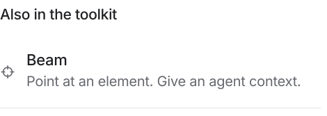</picture><a href="https://github.com/Sherif-Aboulnasr/agent-memory-vault"><picture><source media="(prefers-color-scheme: dark)" srcset="assets/tool-memory-dark.svg">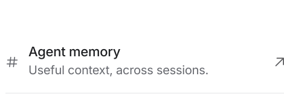</picture></a> 
<a href="https://github.com/Sherif-Aboulnasr/Agent-Screen-Capture-MCP"><picture><source media="(prefers-color-scheme: dark)" srcset="assets/tool-capture-dark.svg"></picture></a><a href="https://github.com/Sherif-Aboulnasr/voicetotext"><picture><source media="(prefers-color-scheme: dark)" srcset="assets/tool-voice-dark.svg">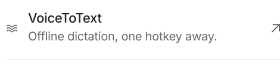</picture></a> 
<picture><source media="(prefers-color-scheme: dark)" srcset="assets/tool-handoffs-dark.svg"></picture><a href="https://github.com/Sherif-Aboulnasr?tab=repositories"><picture><source media="(prefers-color-scheme: dark)" srcset="assets/tool-repos-dark.svg"></picture></a>

<b>What each tool does</b>

 

**Beam.** A browser extension and local bridge that connect a selected UI element to a coding session in the right repository. The dev-server port identifies the project directory.

**Agent memory.** Persistent memory built around linked knowledge graphs, automated regrouping, and two-layer recall, so project context can outlast an individual agent session. [Repository](https://github.com/Sherif-Aboulnasr/agent-memory-vault)

**Screen-capture MCP.** A draggable, click-through overlay defines a screen region that an MCP server captures on demand. Agents can inspect the interface before and after a change. [Repository](https://github.com/Sherif-Aboulnasr/Agent-Screen-Capture-MCP)

**VoiceToText.** Push-to-talk dictation for macOS using local Whisper.cpp transcription. Hold a hotkey, speak, release, and the text is pasted into the focused application. [Repository](https://github.com/Sherif-Aboulnasr/voicetotext)

**Image handoffs.** Self-contained Markdown briefs coordinate image generation across background agents. Original assets stay separate from the compressed copies shipped in a project.

 
 

<picture><source media="(prefers-color-scheme: dark)" srcset="assets/head-workshop-dark.svg">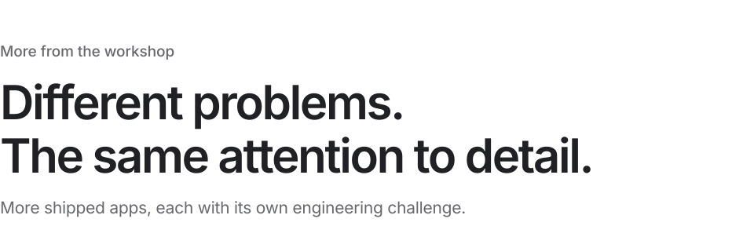</picture>

 

<a href="https://apps.apple.com/us/app/pingr-tcg-restock-alerts/id6778630259"><picture><source media="(prefers-color-scheme: dark)" srcset="assets/app-pingr-dark.svg">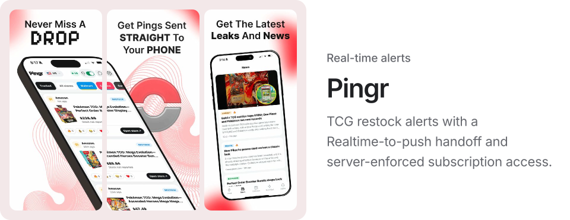</picture></a>

[App Store](https://apps.apple.com/us/app/pingr-tcg-restock-alerts/id6778630259) &nbsp;·&nbsp; [pingr.live](https://pingr.live)

 

<a href="https://apps.apple.com/us/app/umaps-urbex/id6789791291"><picture><source media="(prefers-color-scheme: dark)" srcset="assets/app-umaps-dark.svg">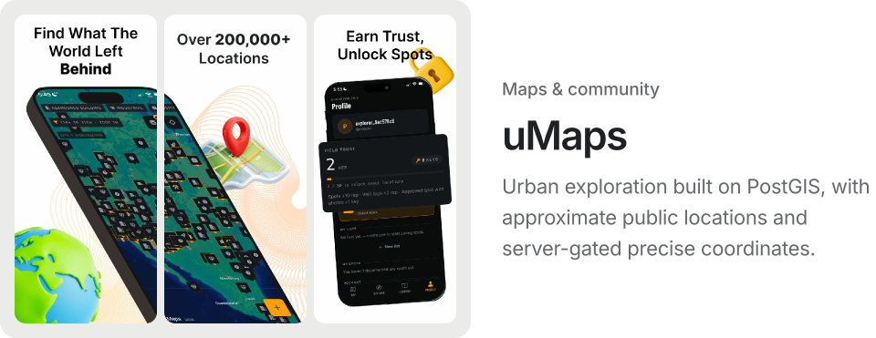</picture></a>

[App Store](https://apps.apple.com/us/app/umaps-urbex/id6789791291) &nbsp;·&nbsp; [umaps.xyz](https://umaps.xyz)

 

<a href="https://apps.apple.com/us/app/stepsy-walk-to-unlock/id6760950247"><picture><source media="(prefers-color-scheme: dark)" srcset="assets/app-stepsy-dark.svg">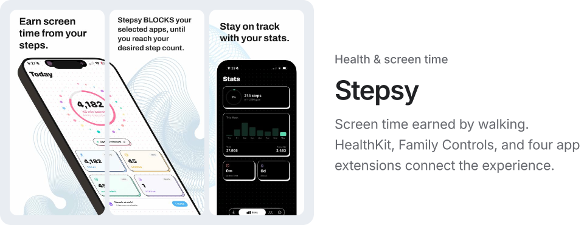</picture></a>

[App Store](https://apps.apple.com/us/app/stepsy-walk-to-unlock/id6760950247) &nbsp;·&nbsp; [stepsy.fit](https://stepsy.fit)

 

<picture><source media="(prefers-color-scheme: dark)" srcset="assets/app-dashfit-dark.svg">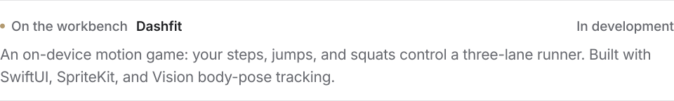</picture>

 
 

<picture><source media="(prefers-color-scheme: dark)" srcset="assets/head-about-dark.svg">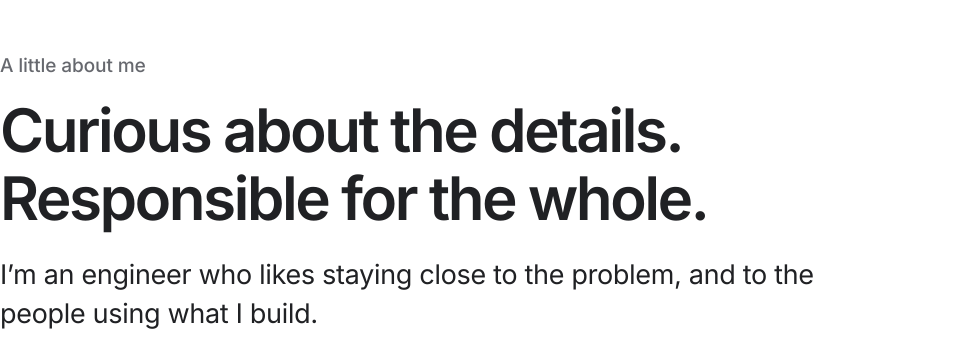</picture>

I co-founded EFN Group. My work spans the interface, the data model, the payment flow, and the production issue that only shows up after launch.

That range shapes how I work: understand the domain, make the important decisions explicit, and keep improving the product after it ships. I bring that same ownership to the teams and people I work with.

<picture><source media="(prefers-color-scheme: dark)" srcset="assets/about-facts-dark.svg">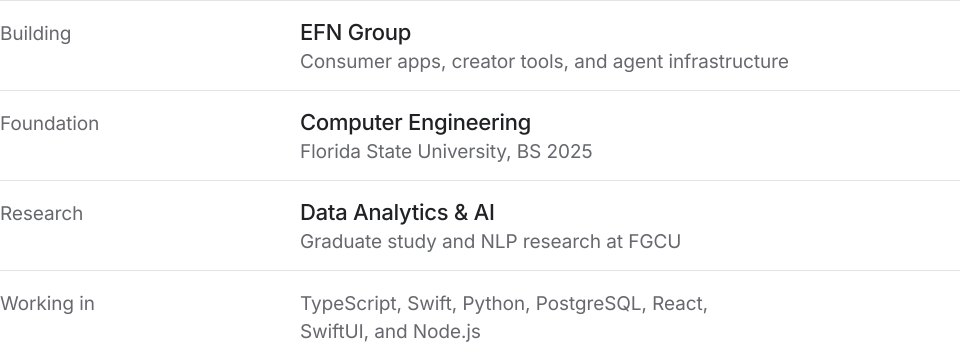</picture>

<picture><source media="(prefers-color-scheme: dark)" srcset="assets/analytical-dark.svg">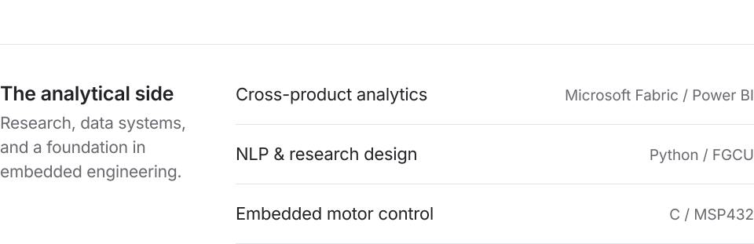</picture>

<b>More on the analytical side</b>

 

**Cross-product analytics.** A three-layer warehouse consolidating product data from PostgreSQL backends, with automated quality checks and a dashboard of users, revenue, and engagement.

**NLP & research design.** A pipeline classifying 600+ research abstracts across eight emotion categories. Separate gamification-in-finance research included a 53-item survey distributed to 200+ respondents.

**Embedded motor control.** Led a four-person FSU capstone team building PID motor control and a data-acquisition pipeline for RPM, torque, and current.

 
 

<picture><source media="(prefers-color-scheme: dark)" srcset="assets/contact-dark.svg">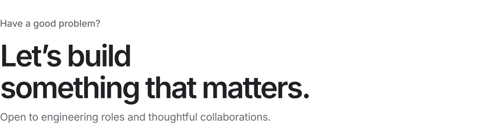</picture>

<a href="https://calendly.com/aboulnasrsherif/30min"><picture><source media="(prefers-color-scheme: dark)" srcset="assets/btn-call-dark.svg"></picture></a>&nbsp;
<a href="mailto:aboulnasrsherif@gmail.com"><picture><source media="(prefers-color-scheme: dark)" srcset="assets/btn-email-dark.svg"></picture></a>&nbsp;
<a href="https://linkedin.com/in/sherif-aboulnasr"><picture><source media="(prefers-color-scheme: dark)" srcset="assets/btn-linkedin-dark.svg"></picture></a>

